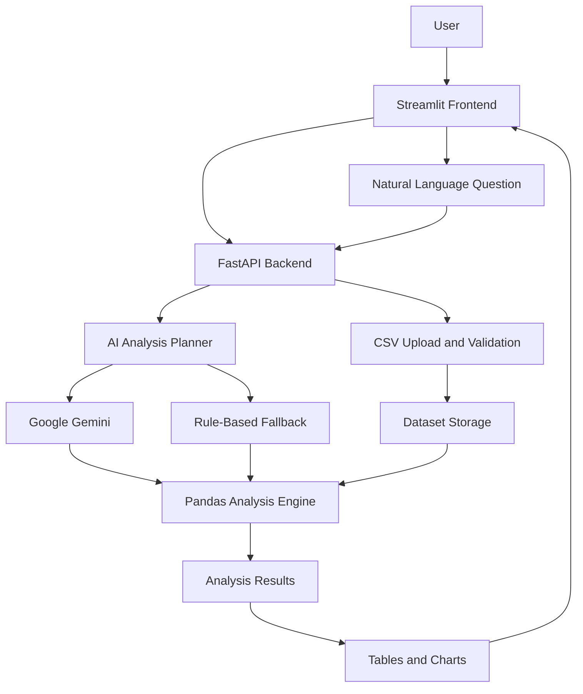
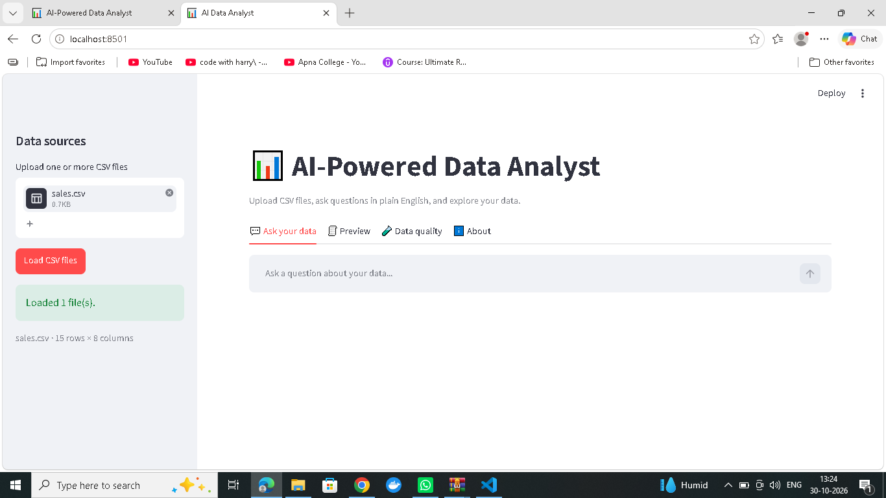
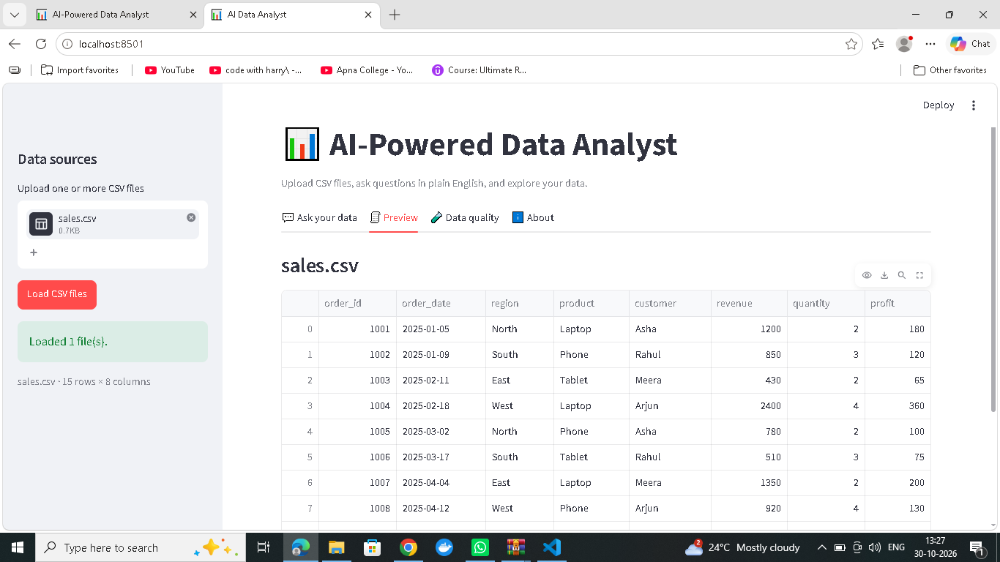
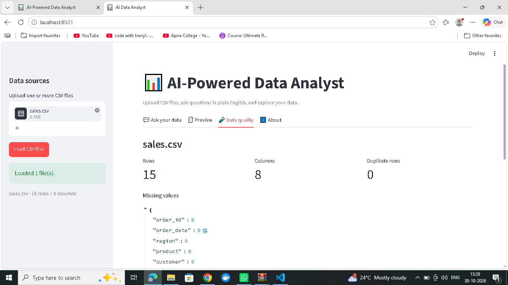
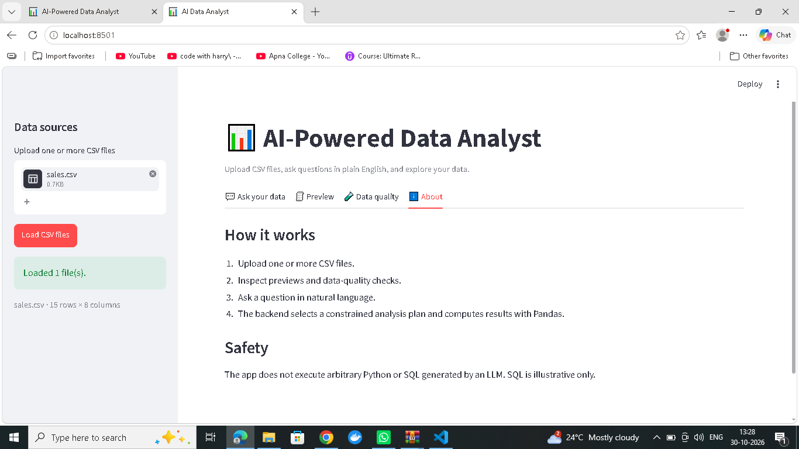

# AI-Powered Data Analyst

An AI-powered data analytics application that allows users to upload CSV files, inspect datasets, identify data quality issues, and ask questions about their data using natural language.

The application combines a Streamlit frontend, FastAPI backend, Pandas-based data processing, Plotly visualizations, and Google Gemini AI for intelligent analysis planning.

Users can explore their datasets, generate grouped summaries, analyze business metrics, visualize results, and identify potential anomalies without writing SQL or Python code.

---

## Key Features

- **CSV File Upload:** Upload one or multiple CSV files.
- **Data Validation:** Validate uploaded CSV files and column structures.
- **Data Preview:** View uploaded datasets in an interactive table.
- **Data Quality Analysis:** Identify missing values, duplicate rows, row counts, column counts, and data types.
- **AI-Powered Analysis:** Ask questions about uploaded datasets in natural language.
- **Automated Data Aggregation:** Calculate sum, average, count, minimum, and maximum values for supported queries.
- **Data Visualization:** Generate interactive charts using Plotly.
- **Regional Analysis:** Compare revenue and other business metrics across different regions.
- **Anomaly Detection:** Identify potential numerical outliers using statistical methods.
- **AI Planning:** Use Google Gemini to generate constrained analysis plans.
- **Fallback Planning:** Use rule-based analysis when Gemini is unavailable.
- **Generated SQL:** Display illustrative SQL queries for supported analyses.
- **Generated Pandas Code:** Display the corresponding Pandas operations.
- **REST API:** Communicate between frontend and backend using FastAPI.
- **Interactive Interface:** Simple and user-friendly Streamlit dashboard.

---

## Technology Stack

| Category | Technologies |
|---|---|
| Programming Language | Python |
| Frontend | Streamlit |
| Backend | FastAPI |
| API Server | Uvicorn |
| Data Processing | Pandas, NumPy |
| Data Visualization | Plotly |
| AI Integration | Google Gemini |
| AI SDK | google-genai |
| Environment Management | python-dotenv |
| Testing | Pytest |
| API Testing | FastAPI TestClient, HTTPX |
| Containerization | Docker |
| Container Management | Docker Compose |
| Version Control | Git and GitHub |

---

## Project Architecture

The application follows a frontend-backend architecture.

1. The user uploads CSV files through the Streamlit interface.
2. The frontend sends the uploaded files to the FastAPI backend.
3. The backend validates and processes the uploaded datasets.
4. The analysis planner interprets natural-language questions.
5. Google Gemini can assist with generating a constrained analysis plan.
6. A rule-based planner provides fallback functionality.
7. Pandas performs the requested data operations.
8. Plotly generates visualizations where supported.
9. Results are returned to the Streamlit frontend.

### Architecture Diagram



---

## Project Structure

```text
AI_DATA_ANALYST_ASSIGNMENT/
│
├── app/
│   ├── __init__.py
│   └── main.py
│
├── backend/
│   ├── __init__.py
│   ├── main.py
│   └── services.py
│
├── docs/
│   ├── screenshots/
│   │   ├── 01-app-home.png
│   │   ├── 02-data-preview.png
│   │   ├── 03-data-quality.png
│   │   ├── 04-about-page.png
│   │   ├── 05-ai-analysis-result.png
│   │   └── 06-revenue-by-region-chart.png
│   │
│   ├── architecture.mmd
│   └── DEMO_SCRIPT.md
│
├── sample_data/
│   └── sales.csv
│
├── tests/
│   └── test_api.py
│
├── .env
├── .env.example
├── .gitignore
├── Dockerfile
├── docker-compose.yml
├── requirements.txt
└── README.md
```

---

## Application Screenshots

### 1. Application Home

The main dashboard provides access to CSV uploads, data preview, data quality analysis, and natural-language questions.



### 2. Data Preview

Displays uploaded CSV data in an interactive table for easy inspection.



### 3. Data Quality Analysis

Displays dataset statistics, missing values, duplicate rows, and column information.



### 4. About Page

Explains the application workflow and its safety features.



### 5. AI Analysis Result

Demonstrates natural-language data analysis and grouped revenue calculations.


### 6. Revenue by Region Chart

Displays an interactive bar chart comparing total revenue across different regions.


---

## Installation and Setup

### Prerequisites

Install the following before running the project:

- Python 3.11 or newer
- Visual Studio Code
- Git
- pip
- Google Gemini API key (optional)
- Docker Desktop (optional)

### Step 1: Clone the Repository

```bash
git clone YOUR_GITHUB_REPOSITORY_URL
```

Move into the project directory:

```bash
cd AI_DATA_ANALYST_ASSIGNMENT
```

### Step 2: Create Virtual Environment

```bash
python -m venv .venv
```

Activate the virtual environment on Windows:

```powershell
.\.venv\Scripts\Activate.ps1
```

### Step 3: Install Dependencies

```bash
pip install -r requirements.txt
```

### Step 4: Configure Environment Variables

Create a `.env` file in the project root.

Add the following configuration:

```env
GEMINI_API_KEY=your_gemini_api_key_here
GEMINI_MODEL=your_supported_gemini_model
BACKEND_URL=http://127.0.0.1:8000
```

Replace the placeholder with your own API key and a model supported by your Gemini API account.

**Security Note:**

- Never upload your actual `.env` file to GitHub.
- Never expose your Gemini API key.
- Keep `.env` inside `.gitignore`.
- Upload only `.env.example` with placeholder values.

Gemini is optional if the rule-based fallback supports the requested analysis.

---

## Running the Application

The application requires two terminals: one for the backend and another for the frontend.

### Step 1: Start the Backend

Open the first VS Code terminal and execute:

```bash
python -m uvicorn backend.main:app --reload --port 8000
```

Backend URL:

```text
http://127.0.0.1:8000
```

Health Check:

```text
http://127.0.0.1:8000/health
```

API Documentation:

```text
http://127.0.0.1:8000/docs
```

### Step 2: Start the Frontend

Open a second VS Code terminal.

Activate the virtual environment if required:

```powershell
.\.venv\Scripts\Activate.ps1
```

Run Streamlit:

```bash
streamlit run app/main.py
```

Frontend URL:

```text
http://localhost:8501
```

The application should now be accessible through your browser.

---

## How to Use the Application

1. Open the application at `http://localhost:8501`.
2. Upload one or more CSV files using the Data Sources panel.
3. Click on the Load CSV Files button.
4. Open the Preview tab to inspect the uploaded dataset.
5. Open the Data Quality tab to review dataset statistics.
6. Navigate to Ask Your Data.
7. Enter a question in natural language.
8. Submit the question for analysis.
9. Review the generated explanation and result table.
10. Explore the interactive chart when available.
11. Expand Generated SQL and Pandas Code to inspect the analysis logic.

---

## Example Questions

Users can ask questions such as:

```text
Which region generated the highest total revenue?
```

```text
Group total revenue by region and sort from highest to lowest.
```

```text
Show total revenue by product.
```

```text
Calculate the average profit.
```

```text
Identify potential anomalies in the dataset.
```

```text
Show a summary of the uploaded dataset.
```

---

## Sample Analysis Result

The application was tested using the included `sales.csv` dataset.

Example question:

**Which region generated the highest total revenue? Show the result in a table and bar chart.**

### Output

| Region | Total Revenue |
|---|---:|
| North | 12,439 |
| South | 3,970 |
| West | 3,870 |
| East | 3,145 |

### Key Finding

**North** generated the highest total revenue in the sample dataset, with a total of 12,439.

The application also generates a bar chart to visually compare revenue across regions.

---

## Backend API Endpoints

The FastAPI backend provides the following REST API endpoints:

| Method | Endpoint | Description |
|---|---|---|
| GET | `/health` | Check backend status |
| POST | `/datasets/upload` | Upload CSV files |
| GET | `/datasets/{dataset_id}/preview` | Retrieve dataset preview |
| GET | `/datasets/{dataset_id}/quality` | Retrieve data quality report |
| GET | `/datasets/{dataset_id}/anomalies` | Retrieve potential anomalies |
| POST | `/analyze` | Analyze natural-language questions |

### API Documentation

FastAPI automatically provides interactive API documentation.

Open:

```text
http://127.0.0.1:8000/docs
```

---

## Testing

The project includes automated API tests using Pytest.

Run the following command from the project root:

```bash
python -m pytest -q
```

### Test Results

The recorded test execution completed successfully:

```text
6 passed, 1 warning
```

The warning was related to a deprecated HTTPX/Starlette test-client configuration and did not cause the recorded tests to fail.

---

## Docker Setup

The project also includes Docker configuration for containerized execution.

Make sure Docker Desktop is installed and running.

Build and start the application:

```bash
docker compose up --build
```

Frontend:

```text
http://localhost:8501
```

Backend:

```text
http://localhost:8000
```

Stop the containers:

```bash
docker compose down
```

---

## Security and Safety

The application follows a constrained analysis approach.

- The application does not execute arbitrary Python code generated by an LLM.
- Generated SQL is illustrative and is not executed against a database.
- Uploaded CSV files are validated before processing.
- The analysis engine performs supported operations using Pandas.
- Potential statistical anomalies are flagged for review rather than automatically treated as errors.
- API credentials are stored in environment variables.

---

## Assumptions and Limitations

- Uploaded datasets are stored in backend process memory.
- Dataset information is cleared when the backend restarts.
- Gemini is used for optional analysis planning.
- A rule-based fallback handles supported question patterns.
- The fallback may not understand every natural-language question.
- Generated SQL is displayed for reference and is not executed.
- Anomaly detection uses the 1.5 × IQR statistical method.
- The application is designed as an assignment/demo project and is not yet hardened for production use.
- Authentication, persistent storage, rate limiting, and multi-user isolation are possible future improvements.

---

## Future Improvements

- Add database integration for persistent storage.
- Add user authentication and authorization.
- Improve natural-language question understanding.
- Add more advanced data visualization options.
- Support Excel and additional file formats.
- Improve anomaly detection.
- Add downloadable analysis reports.
- Deploy the application to a cloud platform.
- Implement production-level security and monitoring.

---

## Assignment Completion Checklist

- [x] Streamlit frontend implemented.
- [x] FastAPI backend implemented.
- [x] CSV upload functionality implemented.
- [x] Dataset preview implemented.
- [x] Data quality analysis implemented.
- [x] Natural-language analysis implemented.
- [x] Gemini integration implemented.
- [x] Rule-based fallback implemented.
- [x] Pandas-based analysis implemented.
- [x] Interactive charts implemented.
- [x] Anomaly detection implemented.
- [x] API endpoints implemented.
- [x] Automated tests included.
- [x] Docker configuration included.
- [x] Application screenshots included.
- [x] README documentation prepared.
- [ ] Demo video recorded and added.
- [ ] Final GitHub repository link added.
- [ ] Final assignment submission completed.

---

## Demo Video

A short demonstration video can showcase:

1. Application home page.
2. Uploading a CSV dataset.
3. Viewing the data preview.
4. Checking data quality.
5. Asking an AI-powered question.
6. Viewing the analysis table and bar chart.

A 10–30 second demonstration is recommended for the assignment.

---

## Author

**Pawan Kumar Yadav** ,**https://github.com/Pyadav231**
**yadavpawan3167gmail.com** ,**+91 7307162565**
AI / ML | Python | Generative AI | Data Analytics

### Project

**AI-Powered Data Analyst**

A data analytics application combining Python, Streamlit, FastAPI, Pandas, Plotly, and Google Gemini.

---

## License

This project was developed as an educational/technical assignment.

